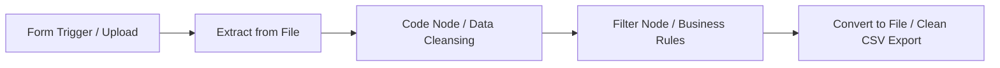

# n8n & Python AI-Driven ETL Automation

A comprehensive, production-grade repository demonstrating automated **ETL (Extract, Transform, Load)** pipelines, node architecture, and event-driven automation using **n8n** and **Python**.

This repository contains end-to-end documentation, architectural guides, workflow exports, and equivalent Python implementations for processing, validating, and transforming tabular datasets.

---

## 📑 Repository Structure

```text
├── README.md
├── docs/
│   ├── 01-n8n-editor-tour.md            # Interactive UI overview, canvas, panels, and shortcuts
│   ├── 02-nodes-and-node-types.md       # Core taxonomy of nodes (Trigger, Action, Logic, Transform)
│   ├── 03-node-types-full-overview.md   # Deep dive into protocols, credentials, and error handling
│   ├── 04-http-vs-webhook-node.md       # Inbound event-driven webhooks vs. outbound polling/calls
│   ├── 05-etl-ai-automation-n8n.md      # Workflow architecture, parsing, validation, and export
│   ├── 06-etl-ai-automation-python.md   # Idiomatic Pandas and Pydantic equivalent implementation
│   └── 07-etl-ai-automation-demo.md     # Step-by-step pipeline execution walkthrough & outputs
├── workflows/
│   └── student-etl-pipeline.json        # Production n8n workflow export (Form -> Extract -> Code -> Filter -> File)
├── scripts/
│   ├── etl_pipeline.py                  # Python equivalent ETL automation script
│   └── requirements.txt                 # Dependencies for local Python execution
└── data/
    └── sample-students.csv              # Reference input dataset
```

---

## 🚀 Key Modules Covered

| Module | Focus Area | Description |
| :--- | :--- | :--- |
| **Editor Tour** | Canvas & Execution Lifecycle | Navigation, canvas controls, input/output inspection, pin data, and test runs. |
| **Node Architecture** | Extensible Blocks | Classification across Triggers, Action Nodes, Logic Routers, and Custom Code blocks. |
| **Protocol Design** | Inbound vs. Outbound | Webhook triggers (push/event-driven) vs. HTTP Request nodes (pull/REST interactions). |
| **ETL Automation (n8n)** | Low-Code Stream Processing | Automated file ingestion via Form Trigger, CSV parsing, JS field sanitization, validation filters, and binary export. |
| **ETL Automation (Python)**| High-Throughput Processing | Clean Python Pandas and regex pipeline matching the n8n data manipulation logic. |

---

## 🛠️ The ETL Pipeline Overview

The pipeline ingests raw student records containing dirty data (inconsistent casing, missing values, non-standardized course names, invalid emails/phones), validates them, and produces a sanitized export:



1. **Extract**: User submits file via `n8n-nodes-base.formTrigger` and `n8n-nodes-base.extractFromFile` decodes the CSV binary.
2. **Transform**: `n8n-nodes-base.code` executes JavaScript logic to:
   - Normalize string casings to Title Case.
   - Clean and standardize courses (`python` -> `Python`, `ml` -> `Machine Learning`).
   - Validate email addresses using RFC regex patterns.
   - Sanitize 10-digit telephone numbers.
3. **Filter**: `n8n-nodes-base.filter` passes only records that satisfy business constraints (`is_valid_email == true` OR `Fee_Paid == 'Yes'`).
4. **Load**: `n8n-nodes-base.convertToFile` encodes the structured JSON stream back into a downloadable CSV asset.

---

## ⚡ Quick Start

### Running the n8n Workflow
1. Open your self-hosted or cloud n8n instance.
2. Click **Workflow Settings > Import from File** and select `workflows/student-etl-pipeline.json`.
3. Activate the workflow or click **Test workflow**.
4. Open the generated Form URL, upload `data/sample-students.csv`, and observe the live execution.

### Running the Python Pipeline
```bash
# Navigate to scripts directory
cd scripts

# Install dependencies
pip install -r requirements.txt

# Run the automated ETL pipeline
python etl_pipeline.py --input ../data/sample-students.csv --output ../data/processed-students.csv
```

---

## 📄 License
MIT License.
